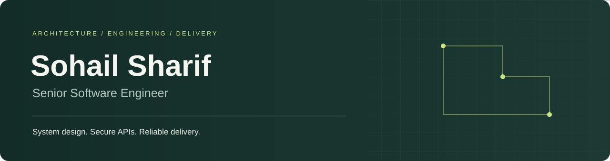

<h1 align="center">Hi, I'm Sohail Sharif 👋</h1>

<strong>Senior Software Engineer</strong>

Scalable applications · Cloud platforms · Intelligent integrations

<a href="https://sohail-sharif-official.github.io/sohail-portfolio/">Portfolio</a> &nbsp; / &nbsp; <a href="https://www.linkedin.com/in/sohail-sharif-4a0735248/">LinkedIn</a> &nbsp; / &nbsp; <a href="mailto:sohailsharif.official@gmail.com">Email</a>

---

## About me

I'm a software engineer with **9+ years of experience** spanning enterprise applications, backend systems, cloud infrastructure and automation. My work connects the product experience with the services, data and infrastructure behind it—from responsive interfaces and secure APIs to deployment pipelines and production monitoring.

I bring an end-to-end perspective: understand the business problem, design maintainable components, integrate systems securely and help teams deliver reliable software. My experience also includes technical leadership, code reviews and engineering mentorship.

## What I work on

| Applications & experiences | Services & integrations | Cloud & reliability |
| :--- | :--- | :--- |
| Responsive interfaces, operational dashboards and full stack product workflows | Backend services, enterprise APIs, asynchronous processing and AI-enabled features | Infrastructure automation, CI/CD, observability, deployment modernization and production support |

## Skills & technologies

| Area | Experience and tools |
| :--- | :--- |
| **Frontend** | React · TypeScript · JavaScript · HTML5 · CSS3 · Bootstrap · Responsive UI · Component-driven development |
| **Backend & APIs** | Python · Java · C# · Go · Node.js · Django · FastAPI · Spring Boot · ASP.NET Core · REST · GraphQL · gRPC |
| **Data & messaging** | PostgreSQL · SQL Server · MySQL · MongoDB · Redis · Elasticsearch · Kafka · Celery · RabbitMQ |
| **Cloud & infrastructure** | AWS · Microsoft Azure · Kubernetes · Docker · Terraform · Linux · Nginx |
| **DevOps & delivery** | GitHub Actions · Jenkins · Azure DevOps · CI/CD · Infrastructure as Code · Container security scanning · Blue-green deployments |
| **AI & integration** | OpenAI · LLM integration · Retrieval-augmented generation (RAG) · Vector embeddings · Document classification · Enterprise API integration |
| **Security & architecture** | OAuth 2.0 · JWT · Role-based access control · Multi-tenant authorization · Microservices · Domain modeling · Caching · Background processing |
| **Observability & quality** | Prometheus · Grafana · CloudWatch · Datadog · Unit and integration testing · Code reviews · Incident response · Performance tuning |

## How I deliver

- **Own the full picture.** Connect application behavior, data flows, deployment and operations.
- **Design for change and failure.** Keep boundaries clear, protect access and make recovery part of the design.
- **Help teams improve.** Share architectural decisions, review code and build repeatable engineering practices.

## Explore my work

Visit my [portfolio](https://sohail-sharif-official.github.io/sohail-portfolio/) for project source code, architecture notes and implementation details.

---

<strong>Thoughtful architecture. Maintainable software. Reliable delivery.</strong> Pennsylvania, United States <a href="mailto:sohailsharif.official@gmail.com">sohailsharif.official@gmail.com</a>

